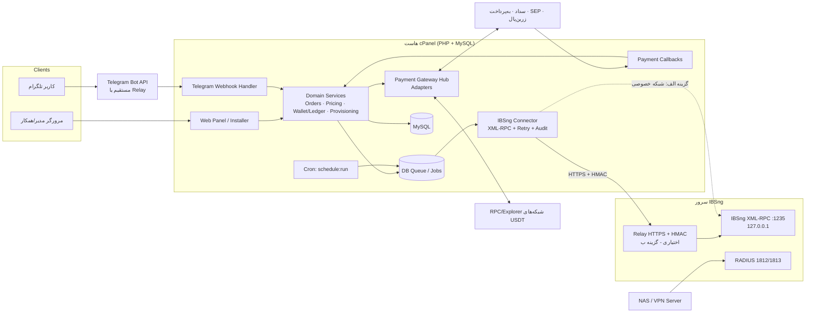
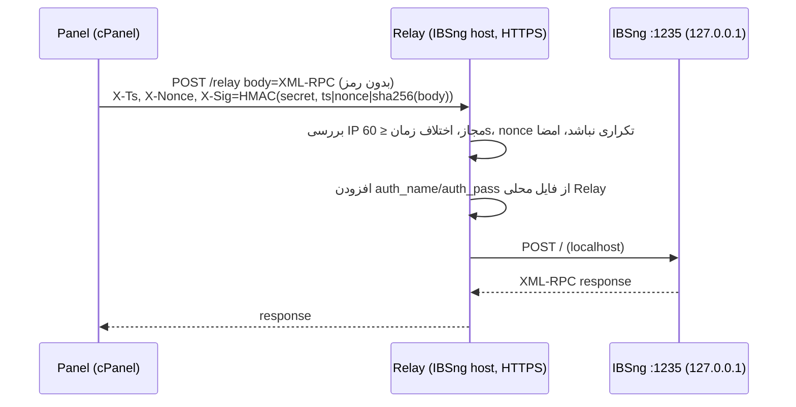

# معماری سامانه و انتخاب فناوری (سازگار با cPanel)

## ۱. انتخاب فناوری و توجیه

| لایه | انتخاب | چرا |
|---|---|---|
| زبان | **PHP 8.2+** | روی همه هاست‌های cPanel (MultiPHP / CloudLinux PHP Selector) موجود است |
| فریم‌ورک | **Laravel (آخرین نسخه پایدار سازگار با PHP 8.2، نسخه دقیق در فاز ۲ قفل می‌شود)** با پوشه `vendor` داخل ZIP | احراز هویت، CSRF، رمزنگاری، Validation، Migration نسخه‌بندی‌شده، صف دیتابیسی و Scheduler آماده و بازبینی‌شده؛ نوشتن این‌ها از صفر ریسک امنیتی دارد |
| دیتابیس | MySQL 5.7+ / MariaDB 10.3+ (InnoDB، utf8mb4) | استاندارد cPanel؛ تراکنش و قفل سطری برای کیف پول |
| رابط کاربری | Blade + CSS سفارشی (Variables/Grid/Flex) + Alpine.js + Chart.js، **از پیش Build شده** | بدون نیاز به Node روی سرور |
| صف | Laravel Database Queue | بدون Redis |
| زمان‌بندی | یک Cron دقیقه‌ای `schedule:run` + **Web-Cron با کلید مخفی** برای هاست‌هایی که Cron CLI محدود دارند | بدون Worker دائمی؛ هر اجرا محدود به زمان مشخص |
| تقویم | تبدیل جلالی داخلی/کتابخانه سبک PHP | بدون وابستگی intl اجباری |
| فونت | IRANSans (فایل فونت باید توسط شما با لایسنس معتبر تأمین شود) + fallback به Vazirmatn (OFL) | مسئله لایسنس |
| XML-RPC | کلاینت اختصاصی بدون وابستگی (همین ابزار فاز ۱) | `ext-xmlrpc` از PHP 8 حذف شده |

**جایگزین بررسی‌شده:** فریم‌ورک سبک دست‌ساز (حجم کمتر، نصب ساده‌تر) — رد شد چون CSRF، نشست، رمزنگاری، Migration و صف را باید از صفر نوشت و ممیزی کرد.

**هشدار:** Laravel پوشه `public` را ریشه وب می‌خواهد. برای cPanel دو حالت پشتیبانی می‌شود: (۱) تنظیم Document Root دامنه/ساب‌دامین روی `public` (توصیه‌شده)، (۲) نصب در `public_html` یا زیرپوشه با `.htaccess` ریشه که همه درخواست‌ها را به `public/` می‌برد و دسترسی به سایر پوشه‌ها را مسدود می‌کند. نصب‌کننده تحت وب هر دو را تست می‌کند.

## ۲. نمودار معماری



## ۳. نقشه ماژول‌ها

| ماژول | مسئولیت | فاز |
|---|---|---|
| `Installer` | بررسی پیش‌نیاز، ساخت `.env`، اجرای Migration، ساخت مدیرکل، قفل نصب | ۲ (هسته) / ۱۰ (نهایی) |
| `Auth & RBAC` | ورود، نشست، نقش‌ها و مجوزها، تأیید مجدد عملیات حساس | ۲ |
| `Audit` | ثبت تغییرناپذیر عملیات حساس | ۲ |
| `Settings & Secrets` | تنظیمات؛ اسرار با `APP_KEY` رمزنگاری می‌شوند و هرگز به Frontend نمی‌روند | ۲ |
| `IbsConnector` | کلاینت XML-RPC، Timeout، Retry فقط برای عملیات خواندنی/Idempotent، لاگ بدون رمز، Circuit Breaker | ۳ |
| `Accounts` | آینه محلی اکانت‌ها، همگام‌سازی، زمان آخرین همگام‌سازی، هشدار داده قدیمی | ۳ |
| `Provisioning` | Saga ساخت/تمدید/افزایش حجم با `provisioning_jobs` | ۳ |
| `Catalog & Pricing` | بسته‌ها، دسته‌ها، نگاشت به گروه IBSng، موتور تخفیف، Snapshot | ۴ |
| `Resellers & Wallet` | همکاران، کیف پول، دفتر کل دوطرفه، قیمت اختصاصی | ۵ |
| `TelegramBot` | Webhook/Polling، منوها، اتصال حساب با OTP | ۶ |
| `Payments` | Hub مرکزی + Adapterها + کارت‌به‌کارت + USDT | ۷ |
| `Notifications` | قالب‌ها، صف ارسال، جلوگیری از تکرار | ۸ |
| `Reports` | KPI، نمودارها، خروجی‌ها | ۹ |

## ۴. API داخلی (Service Contracts)

لایه HTTP فقط با این سرویس‌ها کار می‌کند؛ ربات، پنل و Callbackها از یک مسیر واحد عبور می‌کنند.

```text
IbsConnector
  ping(): HealthResult
  getUsersByIds(int[] ids): IbsUser[]          // getUserInfo دسته‌ای
  findByUsername(string u): ?IbsUser
  createUser(CreateSpec, jobKey): int          // دو مرحله‌ای، Idempotent با jobKey
  updateAttrs(int id, array set, array del): void
  addCredit(int id, float amount, string ref): void
  lock(int id, string reason) / unlock(int id)
  delete(int id, string reason): void
  onlineUsers(): OnlineSession[]
  listGroups(): string[] ; groupInfo(name): Group

ProvisioningService
  provision(Order): ProvisioningJob             // ساخت/تمدید/افزایش حجم
  retry(jobId, actor) / markForManualReview(jobId, reason)

WalletService (فاز ۵)
  credit(walletId, amount, type, ref, idempotencyKey)
  debit(...)  // در یک تراکنش DB با SELECT ... FOR UPDATE؛ موجودی منفی ممنوع
  reverse(entryId, reason, actor)

PricingService (فاز ۴)
  quote(packageId, buyerContext): PriceQuote    // قیمت + قاعده اعمال‌شده
PaymentHub (فاز ۷)
  start(Order, method): Redirect|Invoice ; verify(callback): PaymentResult
```

قواعد مشترک: هر فرمان تغییر‌دهنده یک `idempotency_key` می‌گیرد؛ هر عملیات حساس یک رکورد Audit؛ مبالغ ریالی به‌صورت `BIGINT` (ریال)، USDT به‌صورت `DECIMAL(20,6)`؛ هیچ عدد اعشاری float برای پول.

## ۵. طرح اتصال IBSng



مزیت گزینه «ب»: رمز مدیر IBSng اصلاً روی هاست cPanel ذخیره نمی‌شود و هیچ پورتی جز HTTPS باز نمی‌شود. **اجرای این گزینه نیازمند تأیید شماست** (یک فایل روی سرور IBSng قرار می‌گیرد).

تنظیمات قابل پیکربندی در پنل: حالت اتصال (مستقیم/Relay)، Host، Port، مسیر Relay، Timeout اتصال/پاسخ، تعداد Retry، IP مجاز. نیازمندی فایروال: در حالت مستقیم فقط `TCP 1235` از IP هاست؛ در حالت Relay فقط `TCP 443` از IP هاست.

**سیاست Retry:** عملیات خواندنی تا ۳ بار با Backoff؛ عملیات نوشتنی **هرگز کورکورانه تکرار نمی‌شوند** — ابتدا وضعیت با `getUserInfo` بررسی و سپس ادامه داده می‌شود.

## ۶. تلگرام در هاست ایران

اگر هاست cPanel در ایران باشد، `api.telegram.org` در دسترس نیست. همین مخزن (`vercel.json`) یک Relay برای Bot API دارد. در سامانه «آدرس پایه Bot API» قابل تنظیم است (مستقیم یا Relay). دریافت پیام: Webhook (نیازمند HTTPS معتبر) و در صورت عدم دسترسی، `getUpdates` از Cron. **توکن ربات از مسیر Relay عبور می‌کند؛ Relay باید متعلق به خود شما باشد.**

## ۷. cPanel: نصب، Cron و محدودیت‌ها

- نصب: آپلود ZIP → Extract → ساخت دیتابیس در «MySQL Databases» → باز کردن `/install`.
- Cron پیشنهادی: `* * * * * /usr/local/bin/php /home/USER/app/artisan schedule:run >/dev/null 2>&1` (مسیر PHP توسط نصب‌کننده تشخیص و نمایش داده می‌شود). در هاست‌های محدود به ۵ یا ۱۵ دقیقه، بازه قابل تنظیم است.
- هر اجرای Cron حداکثر N ثانیه (پیش‌فرض ۵۰) کار می‌کند و با قفل دیتابیسی از اجرای همزمان جلوگیری می‌شود.
- حافظه/زمان: همگام‌سازی صفحه‌بندی‌شده؛ خروجی‌های بزرگ Excel/PDF به‌صورت Job پس‌زمینه.
- محیط‌ها: `APP_ENV=local|staging|production`؛ داده آزمایشی فقط با Seeder در غیر production.
