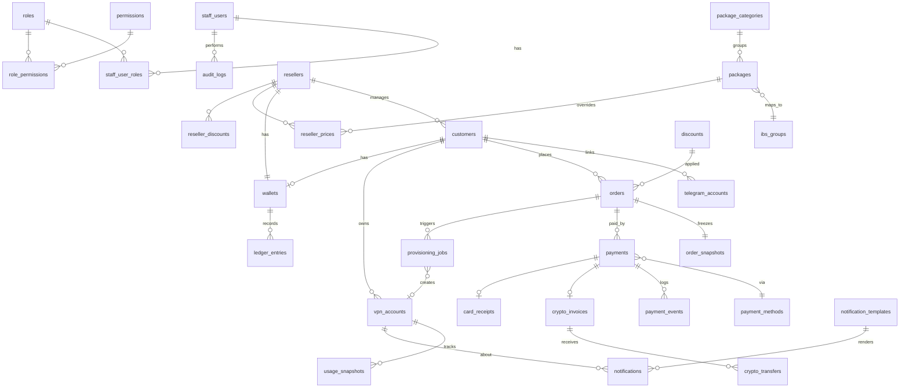

# طرح دیتابیس (ERD اولیه)

> طرح مفهومی فاز ۱. ستون‌های دقیق در Migrationهای هر فاز نهایی می‌شوند. اصول: InnoDB، utf8mb4، کلید خارجی، پول ریالی `BIGINT`، USDT `DECIMAL(20,6)`، زمان‌ها UTC در دیتابیس و نمایش شمسی/تهران.

## جداول اصلی

| گروه | جدول | نکات کلیدی |
|---|---|---|
| دسترسی | `staff_users`, `roles`, `permissions`, `role_permissions`, `staff_user_roles` | همکاران هم کاربر پنل با نقش `reseller` هستند (`staff_users.reseller_id`) |
| ممیزی | `audit_logs` | append-only؛ actor، action، target، before/after (بدون اسرار)، IP، reason |
| تنظیمات | `settings`, `secrets` | `secrets.value` رمزنگاری‌شده با APP_KEY |
| مشتری | `customers`, `telegram_accounts`, `telegram_link_tokens` | `telegram_accounts.telegram_user_id` یکتا؛ OTP یک‌بارمصرف با انقضا |
| IBSng | `ibs_groups` (کش)، `vpn_accounts`, `usage_snapshots`, `sync_runs` | `vpn_accounts.ibs_user_id` و `ibs_username` یکتا؛ `last_synced_at`؛ فیلدهای کش: credit، expiry، online |
| کاتالوگ | `package_categories`, `packages` | نوع: حجمی/زمانی/ترکیبی/تمدید/افزایش حجم؛ `volume_mb`، `duration_value/unit`، `multi_login`، `ibs_group_name`، `price_rial`، `is_active` |
| قیمت | `discounts`, `reseller_discounts`, `reseller_prices` | اولویت: قیمت اختصاصی > تخفیف دسته‌ای همکار > تخفیف سراسری همکار > تخفیف عمومی؛ غیرتجمعی مگر صریحاً تعریف شود |
| سفارش | `orders`, `order_snapshots` | وضعیت‌ها با State Machine؛ `idempotency_key` یکتا؛ Snapshot قیمت و مشخصات بسته |
| تأمین | `provisioning_jobs` | `job_key` یکتا، `ibs_username` رزروشده، `ibs_user_id`، `step`، `attempts`، `last_error`، `next_retry_at` |
| مالی | `wallets`, `ledger_entries` | دفتر دوطرفه؛ `balance` کش‌شده + قابل بازسازی از ledger؛ `idempotency_key` یکتا؛ CHECK موجودی ≥ 0 |
| پرداخت | `payment_methods`, `payments`, `payment_events` | `(method, gateway_ref)` یکتا برای جلوگیری از تأیید دوباره |
| کریپتو | `crypto_invoices`, `crypto_transfers` | `(network, txid, log_index)` یکتا؛ آدرس یکتا یا مبلغ یکتا؛ بدون کلید خصوصی |
| کارت | `card_receipts` | تصویر خارج از public؛ تأیید دو مرحله‌ای مدیر |
| ربات | `bot_settings`, `bot_menus`, `bot_messages`, `support_threads`, `support_messages`, `telegram_updates` | `telegram_updates.update_id` یکتا برای جلوگیری از پردازش تکراری |
| اعلان | `notification_templates`, `notifications` | `(vpn_account_id, type, threshold, period_key)` یکتا → ارسال تکراری ممکن نیست |
| زیرساخت | `jobs`, `failed_jobs`, `cron_runs`, `locks`, `migrations` | |
