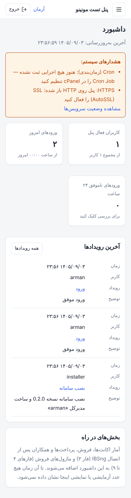
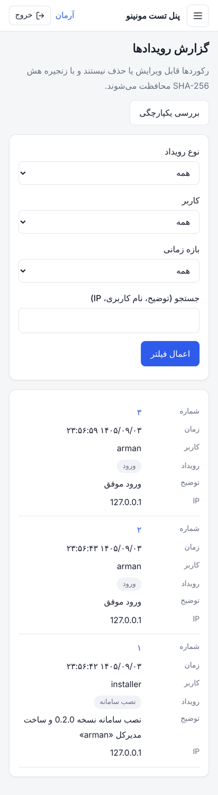
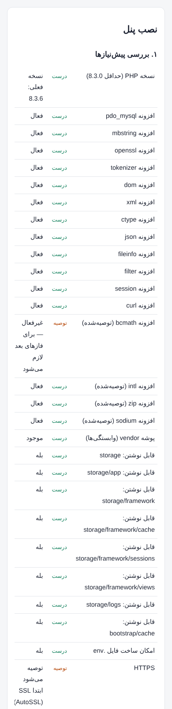
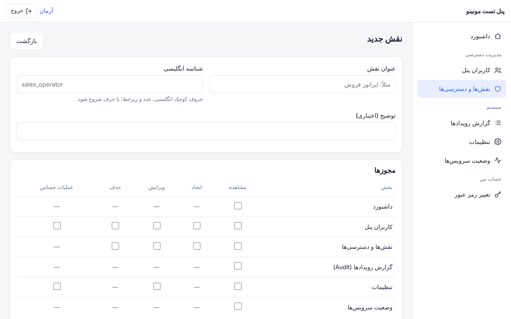

# فاز ۲ — هسته پنل و دسترسی‌ها

**شروع:** 2026-11-24 پس از تأیید کارفرما. **تصمیم‌های ورودی از فاز ۱:** Laravel (vendor داخل ZIP)، تعرفه حجمی `Volume-MB` (اجرا در فاز ۳/۴)، ساعت IBSng دست نمی‌خورد، نسخه اول فقط OpenVPN از طریق IBSng، فونت IRANSans.

## فناوری قفل‌شده

| مورد | مقدار | توضیح |
|---|---|---|
| فریم‌ورک | **Laravel 13** | نسخه پایدار جاری |
| PHP | **8.3 یا بالاتر** | Laravel 13 حداقل 8.3 می‌خواهد. هاست فعلی پیش‌فرض 8.2.36 است ← **قبل از نصب از cPanel ← MultiPHP Manager نسخه 8.3 انتخاب شود** |
| دیتابیس | MySQL 5.7+ / MariaDB 10.3+ | |
| رابط | Blade + CSS/JS ساده بدون Build | بدون Node روی سرور |

## وظایف

1. ساختار پروژه (`panel/`) و محیط‌های `local` / `staging` / `production`.
2. دیتابیس: کاربران پنل، نقش‌ها، مجوزها، Audit Log تغییرناپذیر، تنظیمات (با پشتیبانی مقدار رمزنگاری‌شده)، نشست‌ها.
3. احراز هویت: ورود، خروج، محدودیت تلاش ناموفق، غیرفعال‌سازی کاربر، تغییر رمز (با خروج از سایر دستگاه‌ها)، تأیید مجدد رمز برای عملیات حساس.
4. RBAC: مجوزهای `مشاهده / ایجاد / ویرایش / حذف / عملیات حساس` برای هر ماژول؛ نقش مدیرکل سیستمی و غیرقابل حذف.
5. قالب فارسی RTL واکنش‌گرا با CSS Variables، تاریخ شمسی و اعداد فارسی، حالت‌های خالی/خطا/موفقیت.
6. ماژول‌ها: داشبورد (فقط داده واقعی)، کاربران پنل، نقش‌ها، Audit Log، تنظیمات عمومی، وضعیت سرویس‌ها.
7. نصب‌کننده تحت وب فارسی، `.htaccess` برای نصب در `public_html`، Cron (CLI و Web-Cron)، اسکریپت ساخت ZIP.

## وابستگی‌ها
- فاز ۱ (تأییدشده). هیچ وابستگی به IBSng در این فاز وجود ندارد (اتصال IBSng در فاز ۳).

## معیارهای پذیرش (وضعیت پس از اجرا)
- [x] نصب با آپلود ZIP، ساخت دیتابیس و اجرای `install.php` بدون SSH؛ قفل پس از نصب — **روی Apache 2.4 + mod_rewrite + MariaDB 10.11 در هر دو حالت ریشه `public_html` و زیرپوشه آزمایش شد**.
- [x] ورود/خروج امن؛ قفل ۱۵ دقیقه‌ای پس از ۵ تلاش ناموفق؛ کاربر غیرفعال وارد نمی‌شود و اگر وسط نشست غیرفعال شود خارج می‌شود.
- [x] کاربر بدون مجوز ۴۰۳ می‌گیرد و منوی بخش را نمی‌بیند.
- [x] عملیات حساس: تأیید مجدد رمز (اعتبار ۱۵ دقیقه) + دلیل اجباری.
- [x] Audit Log تغییرناپذیر با زنجیره هش SHA-256؛ دستکاری یا حذف رکورد قابل تشخیص است؛ رمزها و کلیدها `***` می‌شوند.
- [x] فارسی، RTL، بدون اسکرول افقی در ۳۹۰px، تاریخ شمسی و اعداد فارسی.
- [x] بدون دکمه نمایشی؛ داشبورد فقط داده واقعی نشان می‌دهد.
- [x] ۴۲ تست خودکار روی SQLite **و** MariaDB سبز.

---

# گزارش فاز ۲

## ۱. کارهای انجام‌شده

| بخش | جزئیات |
|---|---|
| پروژه | `panel/` — Laravel 13.44، PHP 8.3، بدون Node؛ CSS/JS ساده در `public/assets` |
| محیط‌ها | `local` / `staging` / `production` از طریق `APP_ENV`؛ نصب‌کننده همیشه `production` و `APP_DEBUG=false` می‌نویسد |
| دیتابیس (Migration نسخه‌بندی‌شده) | `users`، `roles`، `permissions`، `permission_role`، `role_user`، `audit_logs`، `settings`، `sessions`، `cache`، `jobs`، `failed_jobs` |
| احراز هویت | ورود با نام کاربری؛ زمان پاسخ یکسان برای نام کاربری ناموجود؛ قفل پس از ۵ خطا (حساب+IP)؛ بازسازی شناسه نشست؛ تغییر رمز با خروج از سایر دستگاه‌ها؛ رمز حداقل ۱۰ کاراکتر شامل حرف و عدد؛ bcrypt |
| RBAC | مجوزها از `config/permissions.php` (ماژول × مشاهده/ایجاد/ویرایش/حذف/عملیات حساس) با `permissions:sync`؛ نقش سیستمی «مدیرکل» غیرقابل حذف/ویرایش؛ فقط مدیرکل می‌تواند نقش مدیرکل بدهد یا حساب مدیرکل را تغییر دهد؛ آخرین مدیرکل فعال قابل حذف/غیرفعال‌سازی نیست |
| کاربران پنل | جستجو، ایجاد، ویرایش، نقش‌ها، فعال/غیرفعال، تعیین رمز، حذف (سوابق Audit با نام کاربری باقی می‌ماند) |
| نقش‌ها | ماتریس مجوز؛ نقش در حال استفاده قابل حذف نیست |
| Audit Log | همه رویدادهای ورود/خروج/ناموفق، کاربران، نقش‌ها، تنظیمات، نصب؛ فیلتر نوع/کاربر/بازه/متن؛ صفحه جزئیات با تغییرات قبل/بعد؛ دکمه «بررسی یکپارچگی» و دستور `audit:verify` |
| تنظیمات | نام سامانه، تماس پشتیبانی، منطقه زمانی نمایش (داده‌ها UTC ذخیره می‌شوند)؛ پشتیبانی از مقدار رمزنگاری‌شده برای اسرار فازهای بعد |
| وضعیت سرویس‌ها | PHP، دیتابیس (نسخه و زمان پاسخ)، Migrationهای اجرانشده، Cron (آخرین اجرا)، صف، دسترسی پوشه‌ها، محیط/Debug، HTTPS |
| امنیت HTTP | CSP سخت‌گیرانه (بدون اسکریپت/استایل inline)، X-Frame-Options، nosniff، HSTS روی https، کوکی نشست رمزنگاری‌شده، CSRF، جلوگیری از ارسال دوباره فرم |
| نصب و استقرار | `install.php` فارسی (سازگار با PHP قدیمی برای نمایش پیام ارتقا)؛ `.htaccess` ریشه برای نصب در `public_html` یا زیرپوشه؛ اسکریپت `deploy/build-release.sh` (ZIP ۱۸MB با vendor) |
| Cron | `schedule:run` (CLI) + Web-Cron با کلید تصادفی؛ Heartbeat برای صفحه وضعیت |
| ابزار CLI | `permissions:sync`، `audit:verify`، `panel:create-admin` (جایگزین نصب‌کننده در صورت نیاز) |

## ۲. نتایج تست

| تست | نتیجه |
|---|---|
| PHPUnit روی SQLite | ✅ ۴۲ تست، ۲۲۱۶۷ assertion |
| PHPUnit روی **MariaDB 10.11** | ✅ ۴۲ تست |
| نصب واقعی از ZIP روی Apache 2.4 + mod_php 8.3 + MariaDB — ریشه `public_html` | ✅ نصب، ورود، همه صفحات ۲۰۰، حذف خودکار install.php |
| همان، در **زیرپوشه** `public_html/sub` | ✅ (پس از رفع باگ تشخیص مسیر پایه) |
| رمز دیتابیس با `# $ "` | ✅ درست در `.env` escape شد |
| دسترسی مستقیم به `.env`، `vendor`، `storage`، `composer.json`، `artisan` | ✅ همه ۴۰۳ |
| نصب‌کننده روی دیتابیس دارای داده دیگر / داده پنل | ✅ رد شد |
| رمز اشتباه دیتابیس | ✅ رمز در خطا نمایش داده نشد |
| آپلود دوباره `install.php` پس از نصب | ✅ ۴۰۳ |
| Cron از CLI به‌عنوان کاربر وب، Web-Cron با کلید درست/غلط | ✅ / ۴۰۴ |
| مرور همه صفحات در موبایل ۳۹۰px و دسکتاپ | ✅ بدون اسکرول افقی، بدون خطای Console |

### باگ‌هایی که در تست پیدا و رفع شد
1. Middleware پیش‌فرض تأیید رمز Laravel روی فرم‌های POST کاربر را به آدرس اشتباه (۴۰۵) برمی‌گرداند ← Middleware اختصاصی که به صفحه فرم برمی‌گرداند.
2. در نصب داخل زیرپوشه، Laravel مسیر پایه را اشتباه تشخیص می‌داد (۴۰۴) ← اصلاح در `public/index.php`.
3. پیش از نصب، لینک «اجرای نصب‌کننده» به `http://localhost` اشاره می‌کرد ← اجبار آدرس فقط پس از نصب.
4. بسته اولیه ۲۸۵MB بود (تاریخچه git وابستگی‌ها) ← ۱۸MB.
5. CSP استایل‌های inline را مسدود می‌کرد ← تبدیل به کلاس CSS.

## ۳. تصاویر
| موبایل — داشبورد | موبایل — گزارش رویدادها | نصب‌کننده |
|---|---|---|
|  |  |  |

دسکتاپ — ماتریس مجوز نقش: 

## ۴. ریسک‌ها و موارد باقی‌مانده
| مورد | توضیح |
|---|---|
| PHP 8.3 روی هاست | باید پیش از نصب از MultiPHP Manager انتخاب شود (هاست الان 8.2). نصب‌کننده در غیر این صورت پیام واضح می‌دهد |
| فونت IRANSans | ✔️ از نسخه 0.2.1: شش وزن (200/300/400/500/700/900) به WOFF2 تبدیل و داخل ZIP قرار گرفت. چون مخزن GitHub عمومی است، فایل‌های فونت در git ثبت نمی‌شوند |
| بازیابی رمز فراموش‌شده | عمداً بدون ایمیل/پیامک؛ مدیرکل رمز دیگران را تعیین می‌کند و برای مدیرکل دستور `panel:create-admin` وجود دارد (نیازمند ترمینال cPanel). در فاز ۶ امکان بازیابی از طریق تلگرام قابل بررسی است |
| تست روی LiteSpeed | آزمایش روی Apache انجام شد؛ LiteSpeed (موتور هاست شما) با همین `.htaccess` سازگار است اما اثبات نهایی با نصب روی هاست شماست |
| داشبورد | آمار فروش/اکانت‌ها در فازهای بعد اضافه می‌شود؛ تا آن زمان عدد ساختگی نمایش داده نمی‌شود |

## ۵. تحویل
- سورس: `panel/` در شاخه `claude/bold-gates-dsbphe`
- بسته نصب: `vpn-panel-0.2.1.zip` (با `deploy/build-release.sh` قابل بازسازی؛ فونت‌ها باید در `panel/public/fonts` موجود باشند)
- 0.2.1: فونت IRANSans در همه وزن‌ها؛ صفحه ورود و نام پیش‌فرض «پنل فروش» (بدون اشاره به VPN)
- راهنمای نصب: [install-guide.md](install-guide.md)

