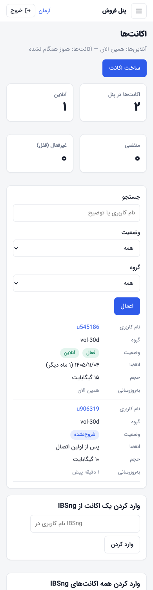
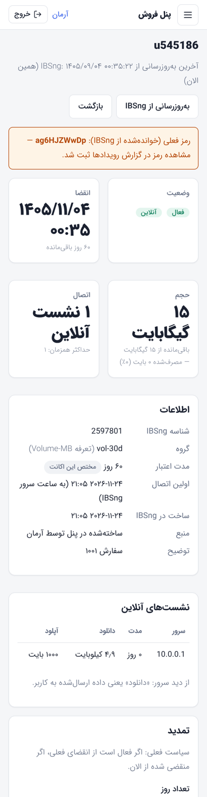
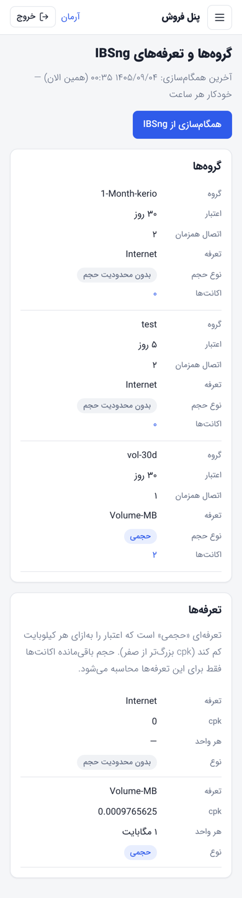
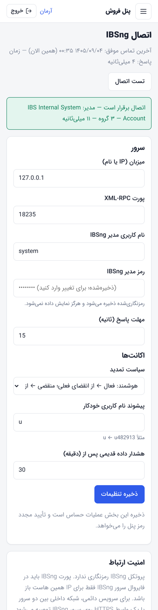

# فاز ۳ — اتصال IBSng و مدیریت اکانت‌ها

**شروع:** پس از نصب موفق نسخه 0.2.1 روی هاست کارفرما و تأیید صریح.
**دامنه:** فقط OpenVPN از طریق IBSng (تصمیم فاز ۱). MikroTik به فاز توسعه بعدی موکول است.

## مبنای فنی (اثبات‌شده در فاز ۱ روی سرور واقعی)
XML-RPC روی `45.9.145.13:1235`؛ متدهای اثبات‌شده: `admin.getAdminInfo`، `group.listGroups/getGroupInfo`، `charge.listCharges/listChargeRules`، `report.getOnlineUsers`، `user.getUserInfo` (با نام کاربری و شناسه)، `normal_user.checkNormalUsernameForAdd`، `user.addNewUsers`، `user.updateUserAttrs`، `user.changeCredit`، `user.delUser`.
متدهایی که در این فاز **اولین بار روی سرور واقعی** اجرا می‌شوند و نتیجه‌شان در پذیرش ثبت می‌شود: `user.searchUser` (وارد کردن همه اکانت‌ها)، حذف ویژگی با `to_del_attrs` (رفع قفل)، `getUserInfo` چندتایی (شناسه‌های جدا با کاما).

## وظایف
1. **کانکتور IBSng:** کلاینت XML-RPC بدون وابستگی، تبدیل خطاهای `CODE|متن` به پیام فارسی، retry فقط برای عملیات خواندنی، قطع‌کننده مدار (circuit breaker) هنگام قطعی، ثبت آخرین تماس موفق/ناموفق، رمز مدیر IBSng رمزنگاری‌شده در تنظیمات.
2. **صفحه اتصال IBSng:** تنظیم میزبان/پورت/مدیر/رمز، تست اتصال (اطلاعات مدیر، تعداد گروه‌ها، زمان پاسخ).
3. **گروه‌ها و تعرفه‌ها:** همگام‌سازی، نمایش مدت اعتبار، تعداد اتصال، تعرفه و حجمی بودن یا نبودن.
4. **اکانت‌ها:** آینه محلی، فهرست با فیلتر، جزئیات زنده، ساخت (دو مرحله‌ای با جبران خطا)، قفل/رفع قفل، تغییر رمز، تمدید (سیاست قابل تنظیم)، افزایش حجم (فقط تعرفه حجمی)، حذف، نمایش رمز (عملیات حساس).
5. **همگام‌سازی:** آنلاین‌ها هر دقیقه، اکانت‌ها به‌صورت دسته‌ای، گروه‌ها ساعتی، وارد کردن اکانت تکی یا همه اکانت‌ها؛ زمان آخرین همگام‌سازی و هشدار داده قدیمی.
6. **اکانت‌های نیازمند رسیدگی:** فهرست ساخت‌های ناموفق با retry امن یا جبران.
7. داشبورد و وضعیت سرویس‌ها با داده واقعی IBSng.

## معیارهای پذیرش
| معیار | آزمایش خودکار + E2E | روی IBSng واقعی شما |
|---|---|---|
| تست اتصال از پنل | ✅ | ⏳ چک‌لیست بند ۱ |
| ساخت اکانت؛ بدون اکانت تکراری در ارسال دوباره/Timeout؛ جبران یا رسیدگی در شکست | ✅ (۱۳ تست شامل Timeout در هر مرحله) | ⏳ بند ۴ |
| قفل/رفع قفل، تغییر رمز، تمدید، حذف + Audit | ✅ | ⏳ بند ۵ |
| حجم فقط برای تعرفه حجمی | ✅ | ⏳ پس از ساخت تعرفه `Volume-MB` |
| انقضا مستقل از ساعت سرور IBSng | ✅ (با اختلاف ساعت ۷:۵۵ شبیه‌سازی شد) | ⏳ بند ۳ |
| آنلاین/آفلاین و هشدار داده قدیمی | ✅ | ⏳ بند ۶ |
| قطعی IBSng پنل را از کار نیندازد | ✅ (قطع‌کننده مدار) | — |
| تست‌ها روی SQLite و MariaDB؛ تست‌های فاز ۲ سبز | ✅ ۸۸ تست | — |

---

# گزارش فاز ۳

## ۱. کارهای انجام‌شده
| بخش | جزئیات |
|---|---|
| کانکتور IBSng | `app/Ibs`: کدک XML-RPC (همان که در فاز ۱ روی سرور واقعی اثبات شد)، تبدیل خطای `CODE|متن` به پیام فارسی با کدهای واقعی IBSng (`INCORRECT_PASSWORD`، `USERID_DOESNT_EXISTS` و…)، retry فقط برای خواندن، **قطع‌کننده مدار** (۳ خطای پیاپی ← ۶۰ ثانیه توقف تا پنل کند نشود)، ثبت آخرین تماس موفق/ناموفق و زمان پاسخ |
| صفحه اتصال IBSng | میزبان/پورت/مدیر/رمز (رمزنگاری‌شده، ذخیره با تأیید مجدد رمز)، تست اتصال، سیاست تمدید، پیشوند نام کاربری، آستانه داده قدیمی |
| گروه‌ها و تعرفه‌ها | همگام‌سازی دستی و ساعتی؛ مدت اعتبار، اتصال همزمان، تعرفه و تشخیص حجمی بودن (cpk) |
| اکانت‌ها | آینه محلی با زمان آخرین همگام‌سازی؛ فهرست با جستجو/فیلتر وضعیت و گروه؛ صفحه جزئیات؛ ساخت؛ قفل/رفع قفل؛ تغییر رمز؛ تمدید؛ افزایش حجم؛ حذف؛ نمایش رمز (حساس)؛ وارد کردن تکی/همه |
| ساخت امن اکانت | Saga دو مرحله‌ای با کلید Idempotency: ارسال دوباره اکانت دوم نمی‌سازد؛ Timeout مرحله ۱ ← «نیازمند رسیدگی» با ردگیری؛ شکست مرحله ۲ ← تلاش دوباره روی همان کاربر یا حذف کاربر خام؛ صفحه «ساخت اکانت‌ها» برای رسیدگی؛ رمز پس از اتمام از دیتابیس پاک می‌شود |
| تمدید | براساس `rel_exp_date` (از اولین اتصال). هوشمند: فعال ← به انقضای فعلی اضافه؛ منقضی ← از الان. انقضای مطلق پشتیبانی نمی‌شود و پیام می‌دهد |
| همگام‌سازی (Cron) | آنلاین‌ها هر دقیقه (و وارد کردن خودکار کاربر آنلاین ناشناخته)، اکانت‌ها هر ۵ دقیقه (دسته‌های ۱۰۰تایی)، گروه‌ها ساعتی، ادامه وارد کردن کلی هر دقیقه، تلاش دوباره ساخت‌های نیمه‌کاره هر دقیقه |
| انقضا | از `time_to_nearest_exp_date` (نسبی) ← **مستقل از ساعت عقب سرور IBSng** |
| داشبورد و وضعیت | کارت‌های کل/آنلاین/انقضا تا ۳ روز/منقضی/قفل؛ ردیف «اتصال IBSng» در وضعیت سرویس‌ها |
| به‌روزرسانی بدون SSH | پس از استخراج نسخه جدید، مدیرکل به صفحه به‌روزرسانی هدایت می‌شود (بقیه صفحه «در حال به‌روزرسانی» می‌بینند)؛ دکمه اجرای Migration + همگام‌سازی مجوزها |
| مجوزهای جدید | `accounts.*` (مشاهده/ساخت/ویرایش/حذف/حساس=نمایش رمز و بستن دستی)، `ibs_groups.*` |

## ۲. نتایج تست
| تست | نتیجه |
|---|---|
| PHPUnit روی SQLite و **MariaDB** | ✅ ۸۸ تست (۴۲ فاز ۲ + ۴۶ جدید) |
| شبیه‌ساز IBSng بر اساس سورس A1.24 و پاسخ‌های واقعی سرور شما (شکل داده، کد خطا، ماه ۳۰روزه، شناسه‌های چندتایی، ساختار خالی بررسی نام کاربری، اختلاف ساعت) | ✅ |
| E2E روی Apache + MariaDB با IBSng شبیه‌سازی‌شده از طریق HTTP واقعی: نصب 0.2.1 ← استخراج 0.3.0 ← به‌روزرسانی وب ← تنظیم و تست اتصال ← همگام‌سازی گروه‌ها ← ساخت اکانت حجمی ۱۰ گیگ ← قفل ← رفع قفل ← تمدید ۳۰ روز ← افزایش ۵ گیگ ← اتصال VPN ← همگام‌سازی آنلاین ← نمایش رمز | ✅ همه مراحل؛ وضعیت سمت IBSng تأیید شد (اعتبار ۱۵۳۶۰ = ۱۵ گیگ، اعتبار ۶۰ روز، قفل برداشته، آنلاین) |

### باگ‌هایی که در تست پیدا و رفع شد
1. خطای «تنظیم‌نشده» به‌اشتباه خطای اتصال حساب می‌شد و قطع‌کننده مدار را فعال می‌کرد.
2. اگر Saga داخل تراکنش دیتابیس اجرا می‌شد، شکست مرحله بعد سابقه کاربر خامِ ساخته‌شده در IBSng را پاک می‌کرد ← قفل + ثبت فوری هر مرحله.
3. **پس از استخراج نسخه جدید و پیش از به‌روزرسانی، داشبورد خطای ۵۰۰ می‌داد** ← هدایت به صفحه به‌روزرسانی.
4. ارسال دوباره فرم ساخت، رمز اشتباه نمایش می‌داد ← رمز فقط در ارسال اول.

## ۳. تصاویر
| داشبورد | اکانت‌ها | جزئیات اکانت | گروه‌ها | اتصال IBSng |
|---|---|---|---|---|
|  |  |  |  |  |

## ۴. به‌روزرسانی هاست از 0.2.1 به 0.3.0
1. cPanel ← Backup ← از دیتابیس پنل نسخه پشتیبان بگیرید.
2. فایل `vpn-panel-0.3.0.zip` را در همان پوشه نصب آپلود و **Extract** کنید و جایگزینی فایل‌ها را تأیید کنید. (`.env` و `storage` شما دست نمی‌خورد.)
3. فایل `public/install.php` دوباره ظاهر می‌شود؛ قفل است، ولی حذفش کنید.
4. وارد پنل شوید ← به صفحه «وضعیت سرویس‌ها» هدایت می‌شوید ← «اجرای به‌روزرسانی».
5. Cron Job را اگر هنوز نساخته‌اید بسازید (برای همگام‌سازی آنلاین‌ها و اکانت‌ها لازم است).

## ۵. چک‌لیست پذیرش روی IBSng واقعی
1. **تنظیمات ← اتصال IBSng:** میزبان `45.9.145.13`، پورت `1235`، مدیر و رمز ← ذخیره ← «تست اتصال» ← باید «اتصال برقرار است — ۹ گروه» نشان دهد.
2. **گروه‌ها و تعرفه‌ها ← همگام‌سازی:** ۹ گروه و ۲ تعرفه؛ همه «بدون محدودیت حجم» (چون `Volume-MB` هنوز ساخته نشده).
3. **اکانت‌ها ← وارد کردن یک اکانت:** `arman2` ← باید گروه `12-Month-kerio` و تاریخ انقضای درست (حدود ۱۴۰۶/۰۴/۱۹) نشان دهد.
4. **ساخت اکانت** در گروه `test` ← در پنل IBSng بررسی کنید که اکانت با همان نام ساخته شده است.
5. روی همان اکانت آزمایشی: **قفل ← رفع قفل** (اولین اجرای واقعی حذف ویژگی)، **تغییر رمز**، **تمدید ۱ روز**، **حذف**.
6. با یک اکانت واقعی به VPN وصل شوید؛ حداکثر یک دقیقه بعد (با Cron) در پنل «آنلاین» شود.
7. **وارد کردن همه اکانت‌ها** (اولین اجرای واقعی `user.searchUser`) ← در «اکانت‌ها» پیشرفت را ببینید.
هر مرحله‌ای خطا داد، اسکرین‌شات پیام را بفرستید.

## ۶. ریسک‌ها و موارد باقی‌مانده
| مورد | توضیح |
|---|---|
| متدهای اجرانشده روی سرور واقعی | `searchUser`، حذف ویژگی قفل با `to_del_attrs`، `getUserInfo` چندتایی — طبق سورس A1.24 پیاده‌سازی و با شبیه‌ساز تست شده‌اند؛ اثبات نهایی با چک‌لیست بالا |
| تعرفه حجمی | تا ساخت `Volume-MB` در IBSng، فروش حجمی ممکن نیست و پنل گزینه حجم را نشان نمی‌دهد |
| حساب `system` | برای کار دائمی یک مدیر اختصاصی IBSng با محدودیت IP بسازید |
| ارتباط رمزنگاری‌نشده | پورت 1235 فقط برای IP هاست؛ Relay HTTPS در صورت نیاز در فاز بعد |
| قطع اتصال کاربر آنلاین (`killUser`) | پیاده‌سازی نشد (به SSH میکروتیک در IBSng وابسته و آزمایش‌نشده است) |
| گزارش مصرف تاریخی (`getConnections`) | به فاز گزارش‌گیری (۹) موکول شد؛ اکنون حجم باقی‌مانده و نشست‌های زنده نمایش داده می‌شود |

