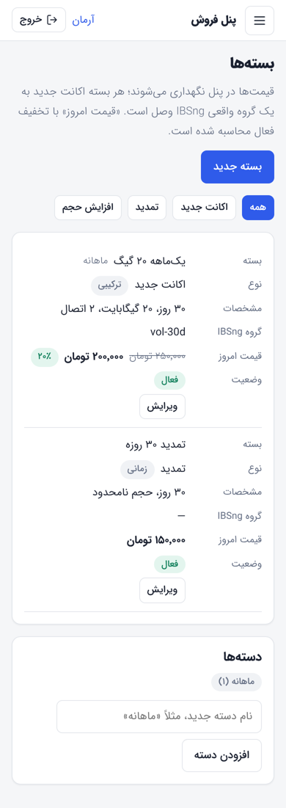
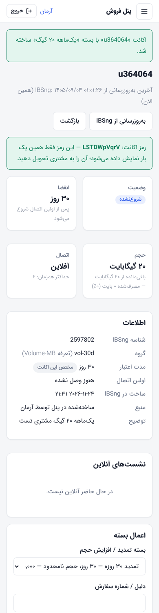
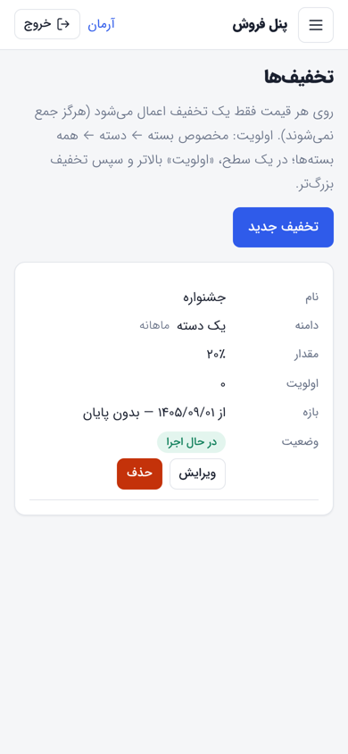

# فاز ۴ — بسته‌ها و موتور قیمت‌گذاری

**ورودی:** فاز ۳ (اتصال IBSng، اکانت‌ها، گروه‌ها و تعرفه‌ها). قیمت‌ها در پنل نگهداری می‌شوند، نه در IBSng؛ هر بسته به یک گروه واقعی IBSng نگاشت می‌شود.

## تعاریف
| نوع بسته | کاربرد | اثر در IBSng |
|---|---|---|
| **اکانت جدید** | فروش اکانت تازه | ساخت اکانت در گروه نگاشت‌شده + مدت (`rel_exp_date`) + تعداد اتصال + حجم (فقط گروه با تعرفه حجمی) |
| **تمدید** | افزودن روز به اکانت موجود (و در صورت تعریف، حجم) | تمدید طبق سیاست فاز ۳؛ حجم فقط برای اکانت‌های حجمی |
| **افزایش حجم** | فقط حجم | `changeCredit` — فقط برای اکانت‌های حجمی |

ماهیت بسته (برای نمایش): **زمانی** (حجم نامحدود)، **حجمی**، **ترکیبی** (حجم + زمان).

## قواعد قیمت (صریح و قابل تست)
1. واحد ذخیره: **ریال** (عدد صحیح)؛ نمایش: تومان (قابل تنظیم).
2. **فقط یک تخفیف** روی هر قیمت اعمال می‌شود؛ تخفیف‌ها **هرگز با هم جمع نمی‌شوند**.
3. ترتیب اولویت: تخفیف **مخصوص همان بسته** ← تخفیف **دسته** ← تخفیف **عمومی (همه بسته‌ها)**. در هر سطح، تخفیفی با «اولویت» بالاتر و در تساوی، تخفیف بزرگ‌تر برای مشتری انتخاب می‌شود.
4. تخفیف فقط بین «از تاریخ» (شامل) و «تا تاریخ» (غیرشامل) و در حالت فعال اعمال می‌شود.
5. قیمت نهایی هرگز منفی نمی‌شود و به واحد گرد کردن (پیش‌فرض ۱۰۰۰ ریال) **رو به پایین** گرد می‌شود.
6. در فاز ۵ قیمت‌های همکاران **بالای همین زنجیره** قرار می‌گیرند (قیمت اختصاصی ← تخفیف دسته همکار ← تخفیف سراسری همکار ← قیمت عمومی).
7. هر قیمت محاسبه‌شده یک **Snapshot** دارد (مشخصات بسته، قیمت پایه، تخفیف انتخاب‌شده، قیمت نهایی، زمان) که با تغییر بعدی بسته یا تخفیف تغییر نمی‌کند؛ سفارش‌های فاز ۶ همین Snapshot را ذخیره می‌کنند.

## وظایف
1. دسته‌ها، بسته‌ها (CRUD، فعال/غیرفعال، ترتیب نمایش، حذف نرم)، تخفیف‌ها.
2. اعتبارسنجی بسته با گروه و تعرفه واقعی IBSng (گروه حجمی ↔ بسته حجمی).
3. موتور قیمت و Snapshot؛ پیش‌نمایش قیمت.
4. ساخت اکانت از روی بسته؛ اعمال بسته تمدید/افزایش حجم روی اکانت (با ثبت Snapshot در Audit).
5. تست محاسبات قیمت، حجم، زمان و مرزهای اعتبار تخفیف.

## معیارهای پذیرش
- [x] بسته ناسازگار با گروه IBSng (حجم برای تعرفه غیرحجمی یا برعکس، گروه ناموجود) ذخیره نمی‌شود.
- [x] قیمت نهایی طبق قواعد؛ هیچ دو تخفیفی جمع نمی‌شوند؛ مرز تاریخ (شروع شامل، پایان غیرشامل) با تست ثانیه‌ای.
- [x] Snapshot پس از تغییر قیمت بسته یا تخفیف ثابت می‌ماند (با هش کنترل).
- [x] ساخت اکانت از بسته و اعمال تمدید/حجم روی IBSng (شبیه‌ساز) اثر درست دارد.
- [x] تست‌های فازهای ۲ و ۳ سبز (۱۰۵ تست روی SQLite و MariaDB).

---

# گزارش فاز ۴ (نسخه 0.4.0)

## کارهای انجام‌شده
| بخش | جزئیات |
|---|---|
| دسته‌ها | ایجاد/حذف (دسته دارای بسته حذف نمی‌شود) |
| بسته‌ها | سه نوع: اکانت جدید، تمدید، افزایش حجم؛ ماهیت زمانی/حجمی/ترکیبی؛ قیمت به تومان (ذخیره به ریال)؛ فعال/غیرفعال؛ ترتیب؛ حذف نرم (سوابق حفظ می‌شود)؛ Audit همه تغییرات |
| اعتبارسنجی با IBSng | گروه باید در IBSng موجود باشد؛ گروه با تعرفه حجمی ⇔ بسته با حجم؛ تمدید بدون روز و افزایش حجم با روز رد می‌شود |
| تخفیف‌ها | درصدی یا مبلغ ثابت؛ دامنه همه/دسته/بسته؛ اولویت؛ بازه تاریخ شمسی (اعداد فارسی یا لاتین)؛ وضعیت «در حال اجرا/آینده/پایان‌یافته» |
| موتور قیمت | یک تخفیف، بدون جمع شدن؛ بسته > دسته > همه؛ اولویت سپس بزرگ‌ترین؛ گرد کردن رو به پایین فقط پس از تخفیف (واحد قابل تنظیم)؛ قیمت منفی نمی‌شود؛ آماده افزودن قیمت همکاران در فاز ۵ |
| Snapshot | مشخصات بسته + قیمت پایه + تخفیف + قیمت نهایی + زمان + هش؛ در ساخت اکانت (کار ساخت) و اعمال بسته (Audit) ثبت می‌شود |
| ساخت اکانت از بسته | گروه، مدت، حجم و تعداد اتصال از بسته؛ قیمت لحظه ساخت ثبت می‌شود |
| اعمال بسته روی اکانت | فقط بسته‌های قابل اعمال نمایش داده می‌شوند (بسته حجمی برای اکانت بدون محدودیت حجم نمایش داده نمی‌شود) |
| تنظیمات | واحد نمایش قیمت (تومان/ریال) و واحد گرد کردن |

## نتایج تست
| تست | نتیجه |
|---|---|
| PHPUnit روی SQLite و MariaDB | ✅ ۱۰۵ تست (۱۶ تست جدید قیمت و بسته) |
| E2E روی Apache: ارتقای 0.3.1 ← 0.4.0، همگام‌سازی گروه، دسته، رد بسته ناسازگار، بسته جدید و تمدید، تخفیف دسته‌ای از تاریخ شمسی، ساخت اکانت از بسته، اعمال تمدید | ✅؛ سمت IBSng: اعتبار ۲۰۴۸۰ (۲۰ گیگ)، ۶۰ روز، ۲ اتصال؛ تخفیف ۲۰٪ فقط روی بسته دسته «ماهانه» |

### باگ‌هایی که در تست پیدا و رفع شد
1. تاریخ با اعداد فارسی (۱۴۰۵/۰۹/۳۰) در فرم تخفیف رد می‌شد ← پشتیبانی یونیکد.
2. بسته تازه‌ساخته‌شده بدون تعیین صریح «فعال»، در همان لحظه غیرفعال حساب می‌شد ← مقادیر پیش‌فرض مدل.

## تصاویر
| بسته‌ها | ساخت از بسته | تخفیف‌ها |
|---|---|---|
|  |  |  |

## به‌روزرسانی هاست
مثل قبل: ZIP را روی پوشه پنل Extract کنید ← ورود ← رمز خود را در کارت به‌روزرسانی وارد و «اجرای به‌روزرسانی» را بزنید.

## ریسک‌ها و موارد باقی‌مانده
| مورد | توضیح |
|---|---|
| فروش حجمی | تا ساخت تعرفه حجمی (`Volume-MB`) در IBSng، فقط بسته‌های زمانی برای گروه‌های فعلی قابل تعریف‌اند |
| پرداخت و سفارش | قیمت‌ها و Snapshot آماده‌اند؛ ثبت سفارش و پرداخت در فازهای ۶ و ۷ |
| قیمت همکاران | در فاز ۵ روی همین موتور اضافه می‌شود |
| چک‌لیست فاز ۳ روی IBSng واقعی | هنوز نتیجه‌ای دریافت نشده است |

